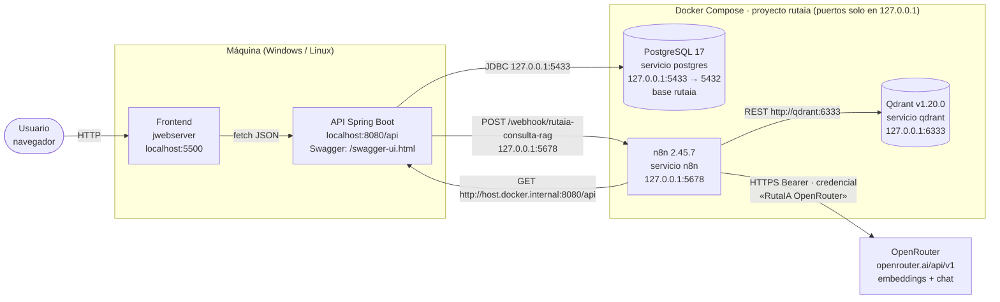
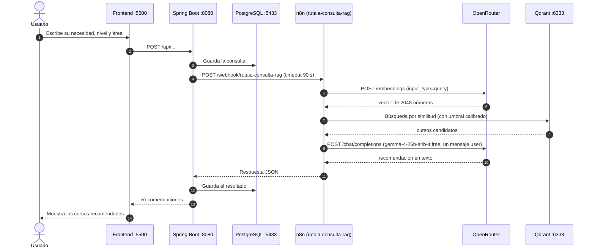
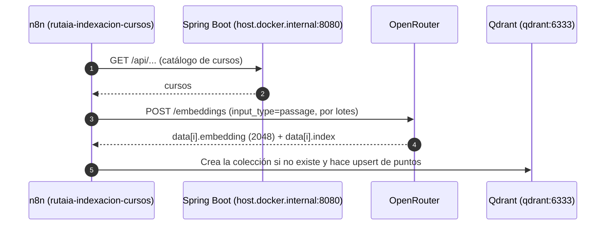

# Arquitectura de RutaIA

RutaIA recomienda cursos existentes de un catálogo institucional a partir de una necesidad escrita en lenguaje natural. Usa una arquitectura RAG (*Retrieval-Augmented Generation*):

- **Frontend** (HTML/CSS/JS servido con `jwebserver` en la máquina) — formulario de consulta y presentación de recomendaciones. Solo habla con la API.
- **API REST Spring Boot** (en la máquina) — única puerta de entrada. Valida, guarda en PostgreSQL y delega la consulta RAG a n8n por webhook.
- **n8n** (contenedor) — orquesta los flujos: genera embeddings con OpenRouter, busca en Qdrant y consulta el LLM.
- **Qdrant** (contenedor) — base vectorial con los embeddings de los cursos (2048 dimensiones).
- **PostgreSQL 17** (contenedor) — base relacional `rutaia` con el catálogo y las consultas.
- **OpenRouter** (externo, capa gratuita) — embeddings `nvidia/nemotron-3-embed-1b:free` y LLM `google/gemma-4-26b-a4b-it:free` (desde la Etapa 5; antes `google/gemma-4-31b-it:free`, ver `docs/n8n.md`). Solo n8n lo llama, con la credencial «RutaIA OpenRouter».

## Diagrama de componentes y puertos

## Flujo de consulta (RAG)

## Flujo de indexación de cursos

## Notas

- A OpenRouter solo viajan la pregunta, el nivel, el área y los datos de los cursos; nunca nombres ni correos.
- La capa gratuita de OpenRouter admite 20 solicitudes por minuto y 50 por día por cuenta.
- Las rutas exactas de la API y los detalles de los flujos los definen las etapas posteriores (`docs/openapi.json`, `docs/n8n.md`).
