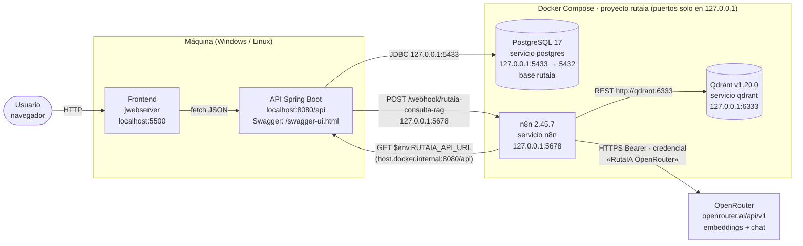
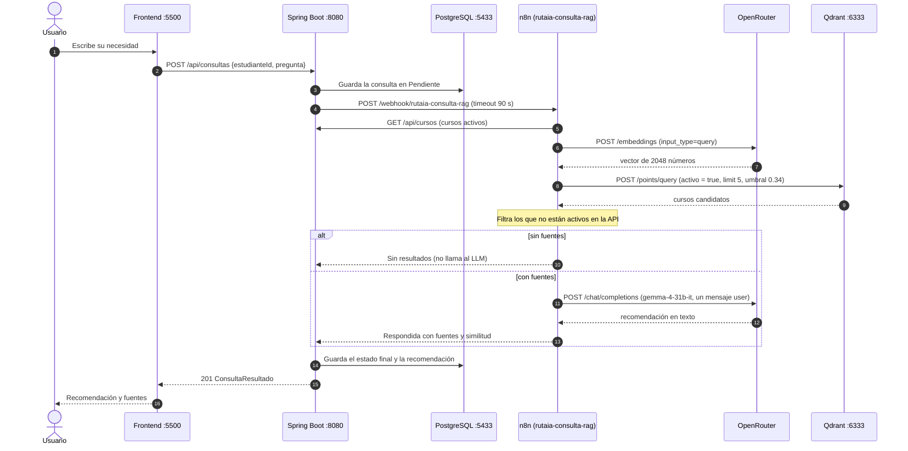
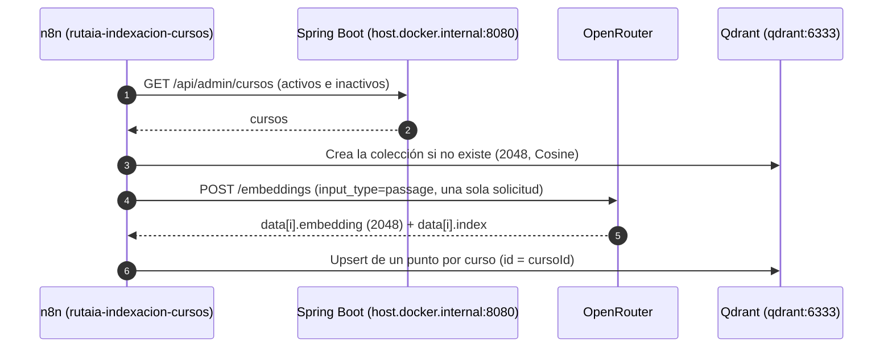
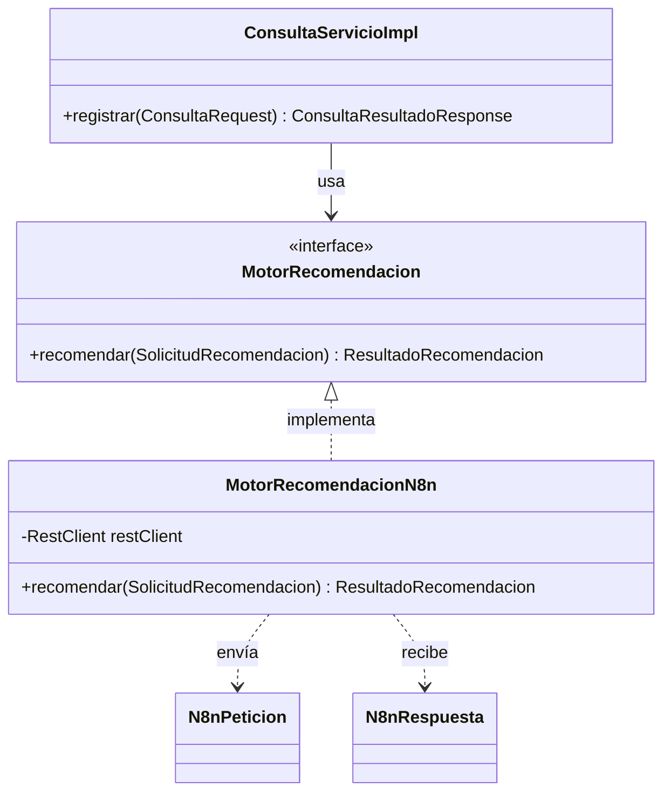

# Arquitectura de RutaIA

RutaIA recomienda cursos existentes de un catálogo institucional a partir de una necesidad escrita en lenguaje natural. Usa una arquitectura RAG (*Retrieval-Augmented Generation*):

- **Frontend** (HTML/CSS/JS servido con `jwebserver` en la máquina): formularios y presentación de recomendaciones. Solo habla con la API.
- **API REST Spring Boot** (en la máquina): única puerta de entrada. Valida, guarda en PostgreSQL y delega la consulta RAG a n8n por webhook.
- **n8n** (contenedor): orquesta los flujos; genera embeddings con OpenRouter, busca en Qdrant y consulta el LLM.
- **Qdrant** (contenedor): base vectorial con los embeddings de los cursos (2048 dimensiones, Cosine).
- **PostgreSQL 17** (contenedor): base relacional `rutaia` con el catálogo y las consultas.
- **OpenRouter** (externo): embeddings `nvidia/nemotron-3-embed-1b:free` y LLM `google/gemma-4-31b-it` (de pago, ver «Decisiones»). Solo n8n lo llama, con la credencial «RutaIA OpenRouter».

## Diagrama de componentes y puertos

Los puertos son los valores por defecto de `.env.example`; cada uno tiene su variable (README, «Puertos»).



## Flujo de consulta (RAG)



## Flujo de indexación de cursos



## Backend

El código de `backend/src/main/java/com/rutaia` sigue una arquitectura en capas. Cada capa es un paquete y solo depende de las de abajo.

```mermaid
flowchart TB
    P["presentacion<br/>controlador · error · documentacion"]
    A["aplicacion<br/>servicio (interfaces) · servicio.impl · dto · mapper · excepcion · puerto"]
    D["dominio<br/>entidades, enumerados y convertidores"]
    R["persistencia<br/>repositorios Spring Data"]
    I["integracion.n8n<br/>MotorRecomendacionN8n"]
    C["configuracion<br/>CORS y OpenAPI (transversal)"]
    P --> A
    A --> D
    A --> R
    R --> D
    I -. implementa aplicacion.puerto .-> A
    I --> D
```

**Reglas**

1. Dirección: presentacion → aplicacion → dominio y persistencia. integracion implementa interfaces de `aplicacion.puerto` y configuracion es transversal. Ninguna capa importa una superior; aplicacion no importa integracion ni presentacion.
2. Los controladores solo hacen HTTP (`@Valid`, códigos y `Location`), dependen de interfaces de `aplicacion.servicio`, reciben y devuelven DTO y nunca tocan entidades ni repositorios.
3. Las interfaces de servicio declaran las operaciones; las implementaciones aplican las reglas y las transacciones y usan repositorios y otros servicios por su interfaz. Las entidades no salen de aplicacion: el mapeo entidad ↔ DTO vive en `aplicacion.mapper`.
4. persistencia contiene solo interfaces de Spring Data, sin lógica de negocio.
5. Solo `integracion.n8n` conoce n8n (URL, JSON del webhook, `RestClient` y timeouts), y todo lo traduce a `SolicitudRecomendacion`, `ResultadoRecomendacion` o `FallaMotorException`.
6. Las excepciones de negocio viven en `aplicacion.excepcion` y `presentacion.error.ManejadorGlobalExcepciones` las traduce a HTTP. `FallaMotorException` nunca llega al manejador: `ConsultaServicioImpl` la convierte en el estado Error.
7. La inyección es siempre por constructor; no hay `@Autowired` en campos.
8. Los DTO son records `XxxRequest` o `XxxResponse` y conservan el nombre de esquema de la API con `@Schema(name = "…")`.
9. No hay dependencias nuevas (ni Lombok, ni MapStruct, ni librerías de pruebas).

Excepción conocida a la regla 2: `CatalogoCursoControlador` recibe el filtro `nivel` como el enumerado `dominio.NivelCurso`, porque el 400 de un nivel inválido lo produce la conversión de Spring MVC antes de llegar al controlador. Si fuera un `String`, cambiaría ese comportamiento.

**SOLID**

| Principio | Dónde se aplica | Cómo se verifica |
|---|---|---|
| S, responsabilidad única | Controladores: HTTP. Servicios: reglas. Mappers: conversión. Repositorios: datos. `ConsultaTransacciones`: límites de transacción. `MotorRecomendacionN8n`: comunicación con n8n | Ningún servicio arma JSON de n8n ni respuestas HTTP; ningún controlador mapea entidades |
| O, abierto/cerrado | Un motor nuevo es una clase nueva que implementa `MotorRecomendacion` | `ConsultaServicioImpl` no cambia para agregarlo (ver «Cómo escala») |
| L, sustitución de Liskov | Contrato de `MotorRecomendacion` en su Javadoc: devuelve Respondida (1–5 fuentes) o Sin resultados, o lanza `FallaMotorException`; nunca null | `MotorRecomendacionN8n` cumple el contrato en la regresión |
| I, segregación de interfaces | `CatalogoCursoServicio` (lectura de activos) separada de `AdministracionCursoServicio`; `ConsultaServicio` (registrar) separada de `HistorialServicio` (lectura) | Cada controlador depende solo de la interfaz que usa |
| D, inversión de dependencias | Los controladores dependen de interfaces de servicio; `ConsultaServicioImpl` depende de `MotorRecomendacion`, nunca de `MotorRecomendacionN8n` | Ninguna clase de aplicacion importa integracion |

**Patrón de diseño: Adapter (estructural).** La aplicación necesita una recomendación y habla con el puerto `MotorRecomendacion`. `MotorRecomendacionN8n` adapta el webhook de n8n a esa interfaz: arma `N8nPeticion`, interpreta `N8nRespuesta` y sus códigos HTTP, valida el contenido según C8 y devuelve un `ResultadoRecomendacion`, o lanza `FallaMotorException` con el motivo. `N8nPeticion` y `N8nRespuesta` son visibles solo dentro de su paquete.



**Patrones ya presentes.** Repository: los repositorios de Spring Data aíslan el acceso a PostgreSQL. DTO: los records de `aplicacion.dto` son el contrato de la API y nunca exponen entidades. Data Mapper: `EstudianteMapper`, `CursoMapper`, `ConsultaMapper` y `CalificacionMapper` convierten entre entidades y DTO.

**Cómo escala**

- Agregar una funcionalidad: (1) la entidad en `dominio`; (2) su repositorio en `persistencia`; (3) la interfaz del servicio en `aplicacion.servicio` y su implementación en `aplicacion.servicio.impl`; (4) los DTO en `aplicacion.dto.<funcionalidad>` y su mapper en `aplicacion.mapper`; (5) el controlador en `presentacion.controlador`, que depende de la interfaz. Las excepciones de negocio existentes ya tienen su traducción a HTTP.
- Agregar un motor: implementar `MotorRecomendacion` en un paquete nuevo de integracion (por ejemplo, `integracion.directo`) cumpliendo el contrato del Javadoc, y elegirlo por configuración: cada adaptador lleva `@ConditionalOnProperty(name = "rutaia.motor", havingValue = "…")` y `application.properties` dice cuál se usa. `ConsultaServicioImpl`, los controladores y el resto de la aplicación no cambian.
- Varias instancias: la API no guarda estado de sesión (todo el estado está en PostgreSQL y cada petición es independiente), así que se pueden levantar varias instancias detrás de un balanceador.

## Frontend

Una sola página en HTML, CSS y JavaScript nativos (módulos ES, Fetch, `async`/`await` y DOM), sin frameworks ni recursos externos. `index.html` carga `js/app.js` y el resto se importa desde ahí; todos los nombres van en minúsculas para que funcione igual en Linux.

```
frontend/js/
├── config.js        API_BASE_URL: la única URL de servidor (http://localhost:8080/api)
├── api.js           único fetch; una función por endpoint y errores 4xx/5xx como ApiError
├── app.js           punto de entrada: pestañas, chip del estudiante activo
├── estudiante.js    estudiante activo (id en localStorage) y aviso de cambios
├── pestanas.js      pestañas accesibles (flechas, Inicio, Fin)
├── registro.js      E-01 registro y E-02 elegir estudiante
├── catalogo.js      E-05 tarjetas y filtros
├── consulta.js      E-11 formulario, espera y resultado
├── resultado.js     vista de E-11 o E-12: recomendación, mensaje y fuentes
├── calificacion.js  E-13 estrellas y comentario
├── historial.js     E-04 historial y E-12 detalle
├── componentes.js · formulario.js · dom.js   piezas compartidas, errores por campo y nodos con textContent
```

## Decisiones

- **Enumerados literales.** Niveles y estados se guardan con su texto exacto (`Básico`, `Sin resultados`): CHECK en la base y `AttributeConverter` con `@JsonValue` en Java, así la base, la API, n8n y el frontend usan el mismo texto.
- **Doble filtro de cursos activos.** Qdrant filtra `activo = true` y «Filtrar fuentes» descarta todo curso que no esté en `GET /api/cursos`, así que un curso desactivado no se recomienda aunque no se haya re-indexado.
- **Umbral 0.34.** Se midió con las consultas de prueba, no se adivinó ([n8n.md, «Calibración»](n8n.md#calibración)).
- **Docker Compose para la infraestructura.** PostgreSQL, Qdrant y n8n con etiquetas exactas (nunca `latest`) y puertos solo en `127.0.0.1`: el mismo entorno en Windows y Linux. El backend y el frontend corren en la máquina.
- **Puertos definidos una vez.** Cada puerto es una variable `RUTAIA_PUERTO_*` de `.env`: la leen Docker Compose y Spring Boot, y n8n recibe `RUTAIA_API_URL`, que los flujos leen desde su entorno con `{{ $env.RUTAIA_API_URL }}`.
- **LLM de pago.** La variante gratuita de Gemma respondía 429 (proveedor saturado) y Google AI Studio 500/504, también con una clave propia. Por decisión del autor, el LLM es `google/gemma-4-31b-it`, el mismo modelo en su variante de pago (centavos por consulta); los embeddings siguen en la capa gratuita.
