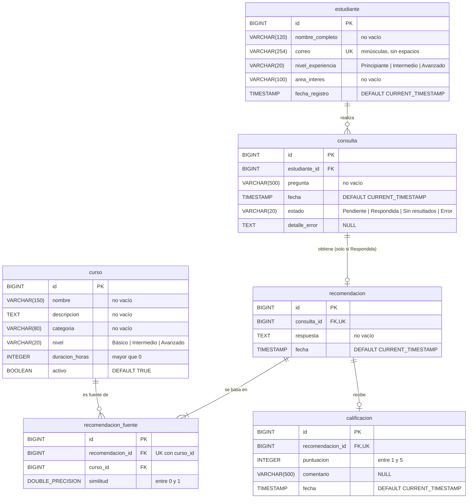

# Base de datos relacional de RutaIA

Base `rutaia` en PostgreSQL 17 (contenedor `postgres`), esquema `public`, codificación UTF8. El esquema lo crean **solo** los scripts de `database/`; Spring Boot no crea ni modifica tablas (`spring.jpa.hibernate.ddl-auto=validate`).

| Archivo | Contenido |
|---|---|
| `database/01_esquema.sql` | Borra (`DROP TABLE IF EXISTS … CASCADE`, en orden inverso de dependencias) y crea las 6 tablas con sus restricciones e índices. |
| `database/02_datos_semilla.sql` | 10 estudiantes y 30 cursos (28 activos y 2 inactivos), sin IDs explícitos: sobre tablas recién creadas salen 1..10 y 1..30. |
| `pruebas/bd/etapa1-conteos.sql` | Consultas de verificación de la semilla (solo lectura). |
| `pruebas/bd/etapa1-restricciones.sql` | 15 casos que deben fallar, cada uno en `BEGIN … ROLLBACK`. |

## 1. Diagrama entidad-relación



Cardinalidades: estudiante 1–N consulta · consulta 1–0..1 recomendación · recomendación 1–N recomendacion_fuente N–1 curso · recomendación 1–0..1 calificación. No hay borrados físicos: ninguna FK tiene `ON DELETE CASCADE`, así que no se puede borrar un estudiante con consultas ni un curso que fue fuente (los cursos se retiran con `activo = FALSE`).

## 2. Tablas y columnas

Todos los `id` son `BIGINT GENERATED ALWAYS AS IDENTITY` (JPA `GenerationType.IDENTITY`). «No vacío» = `CHECK (btrim(col) <> '')`. Toda fecha es `TIMESTAMP NOT NULL DEFAULT CURRENT_TIMESTAMP`.

### estudiante

| Columna | Tipo | Nulo | Restricción | Java |
|---|---|---|---|---|
| id | BIGINT identity | no | `pk_estudiante` | Long |
| nombre_completo | VARCHAR(120) | no | `ck_estudiante_nombre_no_vacio` | String |
| correo | VARCHAR(254) | no | `uq_estudiante_correo`, `ck_estudiante_correo_normalizado` (`correo = lower(btrim(correo))`) | String |
| nivel_experiencia | VARCHAR(20) | no | `ck_estudiante_nivel` (`Principiante`, `Intermedio`, `Avanzado`) | String |
| area_interes | VARCHAR(100) | no | `ck_estudiante_area_no_vacia` | String |
| fecha_registro | TIMESTAMP | no | DEFAULT CURRENT_TIMESTAMP | LocalDateTime |

### curso

| Columna | Tipo | Nulo | Restricción | Java |
|---|---|---|---|---|
| id | BIGINT identity | no | `pk_curso` | Long |
| nombre | VARCHAR(150) | no | `ck_curso_nombre_no_vacio` | String |
| descripcion | TEXT | no | `ck_curso_descripcion_no_vacia` | String (`columnDefinition = "text"`) |
| categoria | VARCHAR(80) | no | `ck_curso_categoria_no_vacia` | String |
| nivel | VARCHAR(20) | no | `ck_curso_nivel` (`Básico`, `Intermedio`, `Avanzado`) | String |
| duracion_horas | INTEGER | no | `ck_curso_duracion_positiva` (`> 0`) | Integer |
| activo | BOOLEAN | no | DEFAULT TRUE | Boolean |

### consulta

| Columna | Tipo | Nulo | Restricción | Java |
|---|---|---|---|---|
| id | BIGINT identity | no | `pk_consulta` | Long |
| estudiante_id | BIGINT | no | `fk_consulta_estudiante` → estudiante(id) | Long |
| pregunta | VARCHAR(500) | no | `ck_consulta_pregunta_no_vacia` | String |
| fecha | TIMESTAMP | no | DEFAULT CURRENT_TIMESTAMP | LocalDateTime |
| estado | VARCHAR(20) | no | DEFAULT `'Pendiente'`; `ck_consulta_estado` (`Pendiente`, `Respondida`, `Sin resultados`, `Error`) | String |
| detalle_error | TEXT | sí | — | String (`columnDefinition = "text"`) |

### recomendacion

| Columna | Tipo | Nulo | Restricción | Java |
|---|---|---|---|---|
| id | BIGINT identity | no | `pk_recomendacion` | Long |
| consulta_id | BIGINT | no | `fk_recomendacion_consulta` → consulta(id); `uq_recomendacion_consulta` | Long |
| respuesta | TEXT | no | `ck_recomendacion_respuesta_no_vacia` | String (`columnDefinition = "text"`) |
| fecha | TIMESTAMP | no | DEFAULT CURRENT_TIMESTAMP | LocalDateTime |

### recomendacion_fuente

| Columna | Tipo | Nulo | Restricción | Java |
|---|---|---|---|---|
| id | BIGINT identity | no | `pk_recomendacion_fuente` | Long |
| recomendacion_id | BIGINT | no | `fk_fuente_recomendacion` → recomendacion(id) | Long |
| curso_id | BIGINT | no | `fk_fuente_curso` → curso(id) | Long |
| similitud | DOUBLE PRECISION | no | `ck_fuente_similitud` (`BETWEEN 0 AND 1`) | Double |
| (recomendacion_id, curso_id) | | | `uq_fuente_recomendacion_curso` | |

### calificacion

| Columna | Tipo | Nulo | Restricción | Java |
|---|---|---|---|---|
| id | BIGINT identity | no | `pk_calificacion` | Long |
| recomendacion_id | BIGINT | no | `fk_calificacion_recomendacion` → recomendacion(id); `uq_calificacion_recomendacion` | Long |
| puntuacion | INTEGER | no | `ck_calificacion_puntuacion` (`BETWEEN 1 AND 5`) | Integer |
| comentario | VARCHAR(500) | sí | — | String |
| fecha | TIMESTAMP | no | DEFAULT CURRENT_TIMESTAMP | LocalDateTime |

## 3. Reglas de negocio y la restricción que las implementa

| Requisito / regla | Restricción |
|---|---|
| RF 01 «Impedir correos duplicados» · «Un correo electrónico solamente podrá pertenecer a un estudiante» | `uq_estudiante_correo` + `ck_estudiante_correo_normalizado`: como el correo debe guardarse en minúsculas y sin espacios, `Ana@x.test` y `ana@x.test` no pueden coexistir. El backend normaliza el correo antes de insertar. |
| RF 01 «Aceptar únicamente los niveles Principiante, Intermedio y Avanzado» | `ck_estudiante_nivel` |
| RF 03 «Administrar identificador, nombre, descripción, categoría, nivel, duración y estado» | Columnas de `curso`; el estado es `activo` |
| RF 03 «Aceptar los niveles Básico, Intermedio y Avanzado» | `ck_curso_nivel` |
| «No podrán registrarse cursos sin nombre o descripción» | `NOT NULL` + `ck_curso_nombre_no_vacio`, `ck_curso_descripcion_no_vacia` |
| «La duración de un curso deberá ser mayor que cero» | `ck_curso_duracion_positiva` |
| RF 07 «Guardar estudiante, pregunta, fecha y estado inicial antes de solicitar la recomendación» | Columnas de `consulta`; `estado DEFAULT 'Pendiente'`, `fecha DEFAULT CURRENT_TIMESTAMP`, `ck_consulta_pregunta_no_vacia` |
| RF 07 «Manejar los estados Pendiente, Respondida, Sin resultados y Error» | `ck_consulta_estado` |
| «Toda consulta deberá pertenecer a un estudiante existente» | `estudiante_id NOT NULL` + `fk_consulta_estudiante` |
| RF 14 «Guardar consulta relacionada, respuesta, fecha, fuentes, similitudes y estado» | `recomendacion` (consulta_id, respuesta, fecha) + `recomendacion_fuente` (curso, similitud); el estado es el de la consulta relacionada. `ck_fuente_similitud` limita la similitud a [0, 1]. |
| RF 14 «Permitir que una recomendación utilice varios cursos como fuentes» | Tabla `recomendacion_fuente` (N:M entre recomendación y curso) con `uq_fuente_recomendacion_curso` para no repetir un curso |
| Una recomendación por consulta | `uq_recomendacion_consulta` |
| RF 17 «Permitir una puntuación entre uno y cinco y un comentario opcional» · «Una recomendación solamente podrá calificarse con valores entre uno y cinco» | `ck_calificacion_puntuacion`; `comentario` admite NULL |
| RF 17 «Aceptar una sola calificación por recomendación» | `uq_calificacion_recomendacion` |
| «Las claves y contraseñas no podrán escribirse directamente en el código ni publicarse en el repositorio» | Los scripts no crean usuarios ni contraseñas: el usuario y la contraseña de PostgreSQL vienen de `RUTAIA_DB_USER` y `RUTAIA_DB_PASSWORD` en `.env` (ignorado por Git). |

## 4. Justificación de los índices

PostgreSQL crea un índice por cada `PRIMARY KEY` y `UNIQUE`, pero **no** indexa las claves foráneas por sí solo; los índices de abajo cubren también las FK (útil para los joins y para comprobar la FK al borrar el padre).

| Índice | Columnas | Justificación |
|---|---|---|
| `uq_estudiante_correo` | estudiante(correo) único | RF 01: impide correos duplicados y busca al estudiante por correo. |
| `idx_curso_catalogo` | curso(activo, categoria, nivel) | RF 04: el catálogo filtra por activos y, opcionalmente, por categoría y nivel; el orden de columnas sirve a los tres filtros. |
| `idx_consulta_estudiante_fecha` | consulta(estudiante_id, fecha DESC) | Historial: consultas de un estudiante de la más reciente a la más antigua, ya ordenadas por el índice. Cubre `fk_consulta_estudiante`. |
| `idx_consulta_estado` | consulta(estado) | Estadísticas: conteos por estado y localización de las `Pendiente`. |
| `uq_recomendacion_consulta` | recomendacion(consulta_id) único | Relación 1:1 consulta–recomendación; acceso a la recomendación de una consulta. Cubre la FK. |
| `uq_fuente_recomendacion_curso` | recomendacion_fuente(recomendacion_id, curso_id) único | Un curso no se repite como fuente de una recomendación; lee las fuentes de una recomendación. Cubre `fk_fuente_recomendacion`. |
| `idx_fuente_curso` | recomendacion_fuente(curso_id) | Estadística «curso más recomendado» (agrupar por curso). El índice único no sirve porque curso_id es su segunda columna. Cubre `fk_fuente_curso`. |
| `uq_calificacion_recomendacion` | calificacion(recomendacion_id) único | RF 17: una sola calificación por recomendación. Cubre la FK. |

## 5. Datos semilla

- **Estudiantes (10)**: ficticios, correos en minúsculas `@rutaia.test`, niveles Principiante (3), Intermedio (4) y Avanzado (3), áreas de interés variadas.
- **Cursos (30)**: 28 activos y 2 inactivos; 7 categorías, todas con ≥ 3 activos; niveles Básico (10), Intermedio (13) y Avanzado (7); descripciones de 130 a 146 palabras con temas, herramientas, proyecto práctico, público y utilidad.

| Categoría | Activos | Cursos (id) |
|---|---|---|
| Desarrollo web | 4 | 1 HTML y CSS · 2 JavaScript y DOM · 3 Responsive · 4 OWASP Top 10 · *(29 Bootstrap, inactivo)* |
| Programación | 4 | 5 Java y POO · 6 APIs REST con Spring Boot · 7 Spring Data JPA · 8 Spring Security |
| Bases de datos | 3 | 9 SQL para análisis · 10 Diseño con PostgreSQL · 11 Bases vectoriales |
| Inteligencia artificial | 5 | 12 Fundamentos de IA · 13 Machine learning · 14 LLM y RAG · 15 PLN · 16 Visión por computadora |
| Automatización | 3 | 17 n8n · 18 RPA · 19 Scripts con Python |
| Análisis de datos | 3 | 20 Python y pandas · 21 Dashboards con Power BI · 22 Estadística |
| Herramientas tecnológicas | 6 | 23 Git · 24 Docker · 25 Kubernetes · 26 CI/CD · 27 Pruebas de seguridad · 28 Linux · *(30 Docker Swarm, inactivo)* |

Cobertura de las consultas de prueba (sección 10), solo con cursos activos:

| Consulta | Cursos pertinentes |
|---|---|
| Quiero aprender a crear páginas web. | 1, 2, 3 (y 29, inactivo: nunca debe recomendarse) |
| Necesito aprender Java para trabajar con Spring Boot. | 5, 6, 7, 8 |
| Me interesa analizar datos y construir dashboards. | 9, 20, 21, 22 |
| Quiero automatizar procesos empresariales. | 17, 18, 19 |
| ¿Qué puedo estudiar para trabajar con inteligencia artificial? | 12, 13, 14, 15, 16 (y 11) |
| Quiero aprender a proteger aplicaciones web. | 4, 8, 27 |
| Necesito desplegar aplicaciones usando contenedores. | 24, 25, 26 (y 30, inactivo: nunca debe recomendarse) |
| Quiero aprender cocina italiana. | Ninguno: ningún curso trata cocina ni gastronomía. |

## 6. Ejecución

### Automática (primer arranque)

Con el volumen `pgdata` vacío, la imagen de PostgreSQL ejecuta los archivos de `/docker-entrypoint-initdb.d` (la carpeta `database/` montada en solo lectura) en orden alfabético: `01_esquema.sql` y luego `02_datos_semilla.sql`. No hay otros archivos en `database/`. Si el volumen ya existe, los scripts **no** se vuelven a ejecutar.

Para reinstalar solo PostgreSQL, sin tocar Qdrant ni n8n (igual en PowerShell y bash):

```bash
docker compose stop postgres
```

```bash
docker compose rm -f postgres
```

```bash
docker volume rm rutaia_pgdata
```

```bash
docker compose up -d postgres
```

### Manual

Iguales en Windows (PowerShell) y Linux (bash), desde la raíz del repositorio:

```bash
docker compose exec postgres psql -U rutaia_app -d rutaia -v ON_ERROR_STOP=1 -f /docker-entrypoint-initdb.d/01_esquema.sql
```

```bash
docker compose exec postgres psql -U rutaia_app -d rutaia -v ON_ERROR_STOP=1 -f /docker-entrypoint-initdb.d/02_datos_semilla.sql
```

> En Git Bash para Windows, antepón `MSYS_NO_PATHCONV=1` para que no convierta la ruta `/docker-entrypoint-initdb.d/…` en una ruta de Windows. En PowerShell y en Linux no hace falta.

Los dos scripts se pueden repetir, siempre **juntos y en ese orden**: `02` solo, sin `01` antes, falla por `uq_estudiante_correo` (los estudiantes ya existen).

Verificación (los scripts de `pruebas/bd/` no están montados: se copian al contenedor; iguales en PowerShell y bash):

```bash
docker compose cp pruebas/bd/etapa1-conteos.sql postgres:/tmp/etapa1-conteos.sql
```

```bash
docker compose exec postgres psql -U rutaia_app -d rutaia -v ON_ERROR_STOP=1 -f /tmp/etapa1-conteos.sql
```

```bash
docker compose cp pruebas/bd/etapa1-restricciones.sql postgres:/tmp/etapa1-restricciones.sql
```

```bash
docker compose exec postgres psql -U rutaia_app -d rutaia -f /tmp/etapa1-restricciones.sql
```

`etapa1-restricciones.sql` se ejecuta **sin** `ON_ERROR_STOP`: cada caso debe imprimir su `ERROR` y continuar con el siguiente.

> **Aviso.** `01_esquema.sql` borra y recrea todas las tablas: se pierden las consultas, recomendaciones y calificaciones. Después de recargar la semilla hay que **re-ejecutar la indexación de cursos en Qdrant (Etapa 3)**, porque los puntos de Qdrant guardan el `id` del curso y su contenido.
>
> Los `INSERT` que fallan (por ejemplo, en `etapa1-restricciones.sql`) consumen valores de las secuencias IDENTITY aunque se haga ROLLBACK. Para volver a tener IDs 1..N, ejecuta `01` y `02` de nuevo.

## 7. Puntos no definidos en el contrato C4 (no se inventaron)

1. **Recomendación solo si la consulta terminó `Respondida`.** C4 lo indica en las relaciones, pero no define un mecanismo en la base (haría falta un trigger). La base no lo impide: lo garantiza el backend al guardar en una misma transacción la recomendación, sus fuentes y el cambio de estado.
2. **`detalle_error` y estado `Error`.** No hay restricción que obligue a llenar `detalle_error` solo cuando el estado es `Error`; queda a cargo del backend.
3. **Comentario vacío en `calificacion`.** C4 lo define como `NULL` sin regla «no vacío»; la base acepta `''`. Se sugiere que el backend convierta un comentario en blanco en `NULL`.
4. **Cantidades de la sección 9 del documento** («Cursos: 20», «Categorías: 5») frente al prompt de la etapa (30 cursos, 7 categorías). Se siguió el prompt de la etapa, que supera los mínimos del documento.
