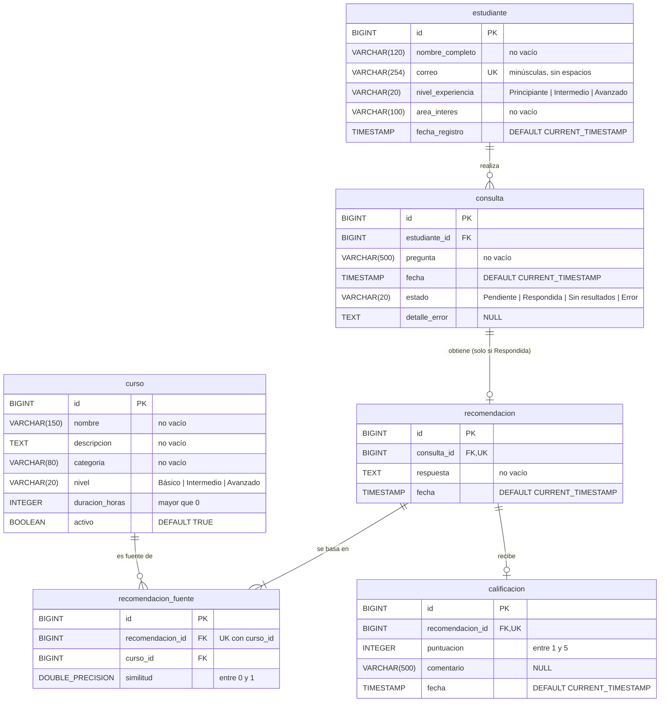

# Base de datos relacional de RutaIA

Base `rutaia` en PostgreSQL 17 (servicio `postgres` de Docker Compose), esquema `public`, codificación UTF8. El esquema lo crean **solo** los scripts de `database/`; Spring Boot no crea ni modifica tablas (`spring.jpa.hibernate.ddl-auto=validate`).

| Archivo | Contenido |
|---|---|
| [database/01_esquema.sql](../database/01_esquema.sql) | Borra (`DROP TABLE IF EXISTS … CASCADE`) y crea las 6 tablas con sus restricciones e índices |
| [database/02_datos_semilla.sql](../database/02_datos_semilla.sql) | 10 estudiantes y 30 cursos (28 activos, 2 inactivos) en 7 categorías y 3 niveles; sobre tablas recién creadas los IDs salen 1..10 y 1..30 |

## Diagrama entidad-relación



Cardinalidades: estudiante 1–N consulta · consulta 1–0..1 recomendación · recomendación 1–N recomendacion_fuente N–1 curso · recomendación 1–0..1 calificación. Ninguna FK tiene `ON DELETE CASCADE`: no se borra un estudiante con consultas ni un curso que fue fuente; los cursos se retiran con `activo = FALSE`.

## Tablas

Todos los `id` son `BIGINT GENERATED ALWAYS AS IDENTITY`. «No vacío» es `CHECK (btrim(col) <> '')`. Toda fecha es `TIMESTAMP NOT NULL DEFAULT CURRENT_TIMESTAMP`. Las columnas son `NOT NULL` salvo `consulta.detalle_error` y `calificacion.comentario`.

| Tabla | Restricciones |
|---|---|
| estudiante | `pk_estudiante`, `uq_estudiante_correo`, `ck_estudiante_correo_normalizado` (`correo = lower(btrim(correo))`), `ck_estudiante_nivel`, `ck_estudiante_nombre_no_vacio`, `ck_estudiante_area_no_vacia` |
| curso | `pk_curso`, `ck_curso_nombre_no_vacio`, `ck_curso_descripcion_no_vacia`, `ck_curso_categoria_no_vacia`, `ck_curso_nivel`, `ck_curso_duracion_positiva` (`> 0`); `activo` DEFAULT TRUE |
| consulta | `pk_consulta`, `fk_consulta_estudiante`, `ck_consulta_pregunta_no_vacia`, `ck_consulta_estado`; `estado` DEFAULT `'Pendiente'` |
| recomendacion | `pk_recomendacion`, `fk_recomendacion_consulta`, `uq_recomendacion_consulta`, `ck_recomendacion_respuesta_no_vacia` |
| recomendacion_fuente | `pk_recomendacion_fuente`, `fk_fuente_recomendacion`, `fk_fuente_curso`, `uq_fuente_recomendacion_curso` (recomendacion_id, curso_id), `ck_fuente_similitud` (`BETWEEN 0 AND 1`) |
| calificacion | `pk_calificacion`, `fk_calificacion_recomendacion`, `uq_calificacion_recomendacion`, `ck_calificacion_puntuacion` (`BETWEEN 1 AND 5`) |

## Regla de negocio → restricción

| Regla | Restricción |
|---|---|
| RF 01 · RN 01: un correo pertenece a un solo estudiante | `uq_estudiante_correo` + `ck_estudiante_correo_normalizado`: `Ana@x.test` y `ana@x.test` no pueden coexistir (el backend normaliza antes de insertar) |
| RF 01: niveles Principiante, Intermedio y Avanzado | `ck_estudiante_nivel` |
| RF 03: niveles Básico, Intermedio y Avanzado | `ck_curso_nivel` |
| RN 03: sin cursos sin nombre o descripción | `NOT NULL` + `ck_curso_nombre_no_vacio`, `ck_curso_descripcion_no_vacia` |
| RN 04: duración mayor que cero | `ck_curso_duracion_positiva` |
| RF 07: guardar la consulta en Pendiente antes de pedir la recomendación | `estado DEFAULT 'Pendiente'`, `fecha DEFAULT CURRENT_TIMESTAMP`, `ck_consulta_pregunta_no_vacia` |
| RF 07: estados Pendiente, Respondida, Sin resultados y Error | `ck_consulta_estado` |
| RN 05: toda consulta pertenece a un estudiante existente | `estudiante_id NOT NULL` + `fk_consulta_estudiante` |
| RF 14: recomendación con varias fuentes y su similitud | `recomendacion_fuente` (N:M con curso), `uq_fuente_recomendacion_curso`, `ck_fuente_similitud` |
| Una recomendación por consulta | `uq_recomendacion_consulta` |
| RF 17 · RN 11: puntuación de 1 a 5, comentario opcional | `ck_calificacion_puntuacion`; `comentario` admite NULL |
| RF 17: una sola calificación por recomendación | `uq_calificacion_recomendacion` |
| RN 07: las fuentes existen en la base | `fk_fuente_curso` |
| RN 12: claves fuera del repositorio | Los scripts no crean usuarios ni contraseñas: vienen de `RUTAIA_DB_USER` y `RUTAIA_DB_PASSWORD` en `.env` |

La base no puede imponer dos reglas, que garantiza el backend: la recomendación solo existe si la consulta terminó Respondida (se guarda en la misma transacción que el estado) y `detalle_error` solo se llena en Error. Un comentario en blanco se guarda como NULL.

## Índices

PostgreSQL crea un índice por cada `PRIMARY KEY` y `UNIQUE`, pero no indexa las claves foráneas por sí solo; estos índices cubren también las FK.

| Índice | Columnas | Justificación |
|---|---|---|
| `uq_estudiante_correo` | estudiante(correo) único | RF 01: impide correos duplicados y busca por correo |
| `idx_curso_catalogo` | curso(activo, categoria, nivel) | RF 04: el catálogo filtra por activos y, opcionalmente, por categoría y nivel |
| `idx_consulta_estudiante_fecha` | consulta(estudiante_id, fecha DESC) | Historial de un estudiante ya ordenado de la más reciente a la más antigua; cubre `fk_consulta_estudiante` |
| `idx_consulta_estado` | consulta(estado) | Estadísticas: conteos por estado |
| `uq_recomendacion_consulta` | recomendacion(consulta_id) único | Relación 1:1 con la consulta; cubre la FK |
| `uq_fuente_recomendacion_curso` | recomendacion_fuente(recomendacion_id, curso_id) único | Un curso no se repite como fuente; lee las fuentes de una recomendación |
| `idx_fuente_curso` | recomendacion_fuente(curso_id) | «Curso más recomendado» (agrupar por curso); el índice único no sirve porque curso_id es su segunda columna |
| `uq_calificacion_recomendacion` | calificacion(recomendacion_id) único | RF 17: una calificación por recomendación; cubre la FK |

## Ejecución de los scripts

**Automática.** Con el volumen `pgdata` vacío, la imagen de PostgreSQL ejecuta los archivos de `/docker-entrypoint-initdb.d` (la carpeta `database/` montada en solo lectura) en orden: `01_esquema.sql` y luego `02_datos_semilla.sql`. Si el volumen ya existe, no se vuelven a ejecutar.

**Manual** (igual en PowerShell y bash, desde la raíz del repositorio). Se ejecutan siempre **juntos y en ese orden**: `02` solo falla por `uq_estudiante_correo`.

```bash
docker compose exec postgres psql -U rutaia_app -d rutaia -v ON_ERROR_STOP=1 -f /docker-entrypoint-initdb.d/01_esquema.sql
docker compose exec postgres psql -U rutaia_app -d rutaia -v ON_ERROR_STOP=1 -f /docker-entrypoint-initdb.d/02_datos_semilla.sql
```

En Git Bash para Windows, antepón `MSYS_NO_PATHCONV=1` para que no convierta la ruta `/docker-entrypoint-initdb.d/…`.

**Reinstalar solo PostgreSQL**, sin tocar Qdrant ni n8n:

```bash
docker compose stop postgres
docker compose rm -f postgres
docker volume rm rutaia_pgdata
docker compose up -d postgres
```

> `01_esquema.sql` borra todas las consultas, recomendaciones y calificaciones. Después de recargar la semilla hay que **re-indexar** los cursos en Qdrant ([n8n.md](n8n.md#indexación)), porque cada punto guarda el `id` y los datos del curso. Los `INSERT` que fallan consumen valores de las secuencias IDENTITY: para volver a tener IDs 1..N, ejecuta `01` y `02` de nuevo.
