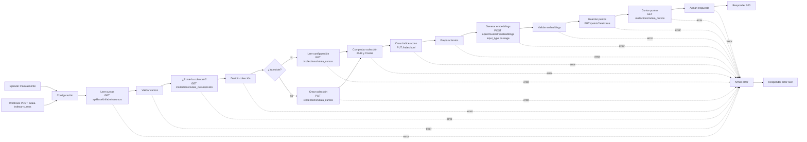

# Flujos de n8n de RutaIA

Los flujos se guardan como JSON en `n8n/` (montada en el contenedor como `/home/node/flujos`). Todos empiezan con el nodo **Configuración** (Edit Fields/Set), que fija la colección, los modelos y las URL; no se usa `$env`, y las llamadas a OpenRouter usan la credencial «RutaIA OpenRouter» (la clave nunca aparece en los JSON).

## Indexación

Flujo **«RutaIA - Indexación de cursos»** (`n8n/rutaia-indexacion-cursos.json`, ID `RutaIAIndexacion`). Lee los cursos de la API, crea o reutiliza la colección `rutaia_cursos` de Qdrant, genera un embedding por curso con OpenRouter y guarda o actualiza un punto por curso.

- Entrada: `POST http://127.0.0.1:5678/webhook/rutaia-indexar-cursos` (sin cuerpo) o el botón *Execute workflow* del editor (Manual Trigger).
- 200: `{"coleccion":"rutaia_cursos","coleccionCreada":false,"cursosLeidos":30,"puntosGuardados":30,"activos":28,"inactivos":2,"totalPuntos":30}`
- 500: `{"error":"Falló el paso «…»: …"}`. Si el fallo viene de OpenRouter, el mensaje incluye el código HTTP (429 cuota agotada, 404 privacidad no habilitada, 402 saldo negativo).
- Lo ejecuta el administrador; nunca el frontend ni Spring Boot.

### Diagrama de nodos



| Nodo | Qué hace |
|---|---|
| Ejecutar manualmente / Webhook | Los dos disparadores. El Webhook responde con los nodos *Respond to Webhook* (`responseMode: responseNode`). |
| Configuración | `coleccion`, `modeloEmbeddings`, `dimensionVector` (2048), `modeloLlm`, `qdrantUrl`, `apiBaseUrl`, `openRouterUrl` (C8). |
| Leer cursos | `GET {apiBaseUrl}/admin/cursos` (E-07): activos e inactivos, id ascendente. |
| Validar cursos | HTTP 200, arreglo con al menos 20 cursos, ids enteros sin repetir, nombre, descripción, categoría y nivel no vacíos, duración entera > 0 y `activo` booleano. |
| ¿Existe la colección? → Decidir colección → ¿Ya existe? | `GET /collections/rutaia_cursos/exists` y bifurcación por `result.exists`. |
| Crear colección | Si no existe: `PUT /collections/rutaia_cursos` con `{"vectors":{"size":2048,"distance":"Cosine"}}`. |
| Leer configuración | Si ya existe: `GET /collections/rutaia_cursos`. |
| Comprobar colección | Si ya existía, exige un vector sin nombre de `size` 2048 y `distance` Cosine; si no coincide, falla **sin borrar nada**. Calcula `coleccionCreada`. |
| Crear índice activo | `PUT /collections/rutaia_cursos/index?wait=true` con `{"field_name":"activo","field_schema":"bool"}` (idempotente). |
| Preparar textos | Texto de C9 por curso, en 4 líneas: `{nombre}` / `Categoría: {categoria}` / `Nivel: {nivel}` / `{descripcion}`. |
| Generar embeddings | **Una sola** solicitud a OpenRouter con `input` como arreglo de todos los textos, `"input_type":"passage"` y `"encoding_format":"float"`, con la credencial «RutaIA OpenRouter». |
| Validar embeddings | HTTP 200 y sin `error`; tantos vectores como cursos; ordenados por `index` y con índices 0..n−1; cada vector con exactamente 2048 números finitos. Arma los puntos. |
| Guardar puntos | `PUT /collections/rutaia_cursos/points?wait=true` con todos los puntos. |
| Contar puntos / Armar respuesta | Comprueba que el upsert quedó `completed` y lee `points_count` de la colección. |
| Armar error / Responder error | Todos los nodos HTTP y Code tienen la salida de error conectada aquí; responde 500 con el paso que falló. |

Todo lo que no gasta cuota (leer y validar la API, preparar Qdrant y el índice) va **antes** de llamar a OpenRouter: con la API o Qdrant caídos el flujo responde 500 sin gastar solicitudes. Cada ejecución gasta **1** solicitud (de 20 por minuto y 50 por día por cuenta).

Los nodos HTTP usan *Include Response Headers and Status* y *Never Error* para que los nodos Code puedan revisar el código HTTP y dar un mensaje claro; los errores de conexión (servicio caído) salen por la salida de error del nodo.

### Cómo evita duplicados y cómo relaciona cada punto con su curso

- El ID de cada punto es el `id` del curso en PostgreSQL (entero). El upsert de Qdrant es por ID: si el punto ya existe, se reemplazan su vector y su payload; si no, se crea. Re-ejecutar el flujo no agrega puntos (con la semilla, `totalPuntos` queda en 30).
- El payload repite el identificador como `cursoId` y guarda los datos descriptivos del curso, con este formato exacto:
  `{"cursoId":1,"nombre":"…","descripcion":"…","categoria":"…","nivel":"Básico","duracionHoras":40,"activo":true}`
- La colección se crea solo si no existe; si existe, se reutiliza tras comprobar su configuración.

### Cuándo re-ejecutarlo

Después de **cargar, cambiar o desactivar cursos** (E-06, E-09, E-10 o una recarga de la semilla). El flujo no sincroniza solo:
- Un curso nuevo no aparece en las búsquedas hasta re-indexar.
- Un curso cambiado conserva el vector y el payload viejos hasta re-indexar.
- Un curso desactivado queda con `activo: true` en Qdrant hasta re-indexar; al hacerlo, el punto se actualiza a `activo: false` y el filtro `activo = true` del flujo RAG lo excluye. (El flujo RAG además descarta los cursos que no estén en `GET /api/cursos`.)
- El flujo nunca borra puntos: un curso eliminado de PostgreSQL seguiría en Qdrant.

### Cómo importarlo y publicarlo

1. Con los contenedores arriba, importa el JSON (desde la raíz del repositorio):

   ```bash
   docker compose exec n8n n8n import:workflow --input=/home/node/flujos/rutaia-indexacion-cursos.json
   docker compose exec n8n n8n list:workflow
   ```

   Debe aparecer `RutaIAIndexacion|RutaIA - Indexación de cursos`.
2. Credencial: el JSON referencia «RutaIA OpenRouter» por ID (`zLvfa0tPU6IKdFZW`, el de la máquina donde se creó). En otra máquina el ID será distinto: abre el flujo en http://localhost:5678, entra al nodo **Generar embeddings**, elige tu credencial «RutaIA OpenRouter» en *Credential for Header Auth* y guarda.
3. Publica y reinicia n8n (la CLI avisa que el cambio se aplica al reiniciar):

   ```bash
   docker compose exec n8n n8n publish:workflow --id=RutaIAIndexacion
   docker compose restart n8n
   ```

   También se puede publicar desde el editor con el botón **Publish**; en ese caso no hace falta reiniciar.
4. Para guardar en el repositorio la versión publicada:

   ```bash
   docker compose exec n8n n8n export:workflow --id=RutaIAIndexacion --published --output=/home/node/flujos/rutaia-indexacion-cursos.json --pretty
   ```

   Antes de versionarlo quita del JSON el bloque `"shared"` (trae el nombre y el correo del propietario de n8n) y comprueba que no haya claves: `git grep -nE "sk-or-v1|Bearer " -- n8n/` no debe mostrar nada.

### Cómo ejecutarlo

Requisitos: contenedores arriba y la API (`bootRun`) en ejecución.

PowerShell:

```powershell
curl.exe -s -X POST http://127.0.0.1:5678/webhook/rutaia-indexar-cursos
```

bash:

```bash
curl -s -X POST http://127.0.0.1:5678/webhook/rutaia-indexar-cursos
```

Desde el editor: abre el flujo y pulsa *Execute workflow* (usa el Manual Trigger; la respuesta queda en el nodo **Armar respuesta** o **Armar error**).

Comprobación en Qdrant (panel en http://127.0.0.1:6333/dashboard):

```bash
curl -s http://127.0.0.1:6333/collections/rutaia_cursos
curl -s -X POST http://127.0.0.1:6333/collections/rutaia_cursos/points/scroll -H "Content-Type: application/json" -d '{"limit":2,"with_payload":true,"with_vector":false}'
```

En PowerShell, el cuerpo del scroll va en un archivo:

```powershell
curl.exe -s http://127.0.0.1:6333/collections/rutaia_cursos
curl.exe -s -X POST http://127.0.0.1:6333/collections/rutaia_cursos/points/scroll -H "Content-Type: application/json" --data-binary "@pruebas/n8n/etapa3-qdrant-scroll.json"
```
